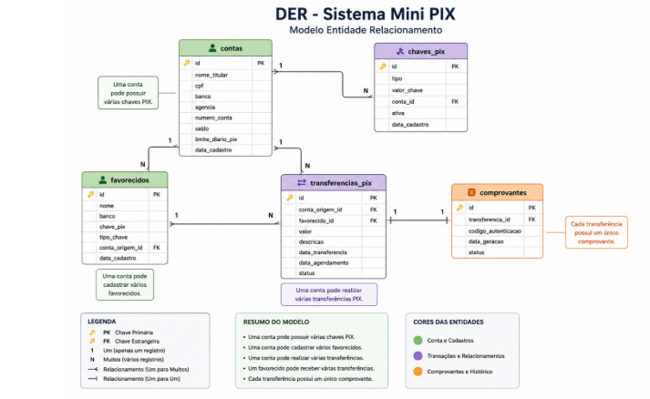

# Minpix

Minpix é uma aplicação Java com Spring Boot para cadastro e consulta de contas bancárias, chaves Pix, favorecidos, transferências Pix e comprovantes. O projeto disponibiliza uma API REST com operações CRUD para essas entidades.

## Situação atual

Estão implementados:

- Entidades JPA e repositórios Spring Data JPA para contas, chaves Pix, favorecidos, transferências Pix e comprovantes.
- Serviços de persistência e controllers REST para listar, consultar por ID, cadastrar, atualizar e excluir registros.
- Documentação OpenAPI/Swagger dos endpoints.
- Cadastro de conta, chave Pix e favorecido com preenchimento automático da data de cadastro.

As operações de transferência Pix atualmente apenas persistem os dados informados: não movimentam saldo, verificam limites, executam agendamentos nem integram com a infraestrutura do Pix. Datas, status e relacionamentos de transferências e comprovantes precisam ser informados; não há regras gerais que os preencham automaticamente.

Os endpoints usam DTOs para entrada e saída, sem expor diretamente as entidades JPA nem a senha das contas nas respostas. As requisições são validadas com Bean Validation, incluindo a anotação `@CPF` do Hibernate Validator, dígitos verificadores de CNPJ, correspondência entre tipo e valor de chave Pix e limites para valores monetários. A aplicação exige um JWT emitido pelo Auth0 nas rotas REST, mas ainda não valida o audience configurado; portanto, a proteção está incompleta. Ainda faltam regras completas de negócio. A aplicação é um projeto em desenvolvimento e não deve ser usada em produção ou com dados financeiros reais.

## API REST

Todos os recursos abaixo oferecem:

| Operação | Método e caminho | Resposta esperada |
|---|---|---|
| Listar | `GET /{recurso}` | `200 OK` com a lista |
| Consultar por ID | `GET /{recurso}/{id}` | `200 OK` ou `404 Not Found` |
| Cadastrar | `POST /{recurso}` | `201 Created` |
| Atualizar | `PUT /{recurso}/{id}` | `200 OK` ou `404 Not Found` |
| Excluir | `DELETE /{recurso}/{id}` | `204 No Content` ou `404 Not Found` |

Os recursos disponíveis são:

| Recurso | Caminho |
|---|---|
| Contas | `/contas` |
| Chaves Pix | `/chaves-pix` |
| Favorecidos | `/favorecidos` |
| Transferências Pix | `/transferencias-pix` |
| Comprovantes | `/comprovantes` |

Os corpos de cadastro e atualização são JSON com os campos dos DTOs de requisição. Relacionamentos são informados por ID (`contaId`, `contaOrigemId`, `favorecidoId` e `transferenciaId`), e as respostas retornam esses IDs sem incluir entidades aninhadas. A senha é aceita no cadastro da conta, mas nunca aparece nas respostas.

Exemplo de cadastro de conta:

```json
{
  "nomeTitular": "Maria Silva",
  "cpf": "529.982.247-25",
  "banco": "Banco XPTO",
  "agencia": "0001",
  "numeroConta": "12345-6",
  "senha": "senha-segura",
  "saldo": 1500.50,
  "limiteDiario": 1000.00
}
```

O CPF pode ser enviado com pontuação ou apenas com os 11 dígitos, mas precisa ter dígitos verificadores válidos. Chaves Pix aceitam os tipos `CPF`, `CNPJ`, `EMAIL`, `TELEFONE` e `ALEATORIA`, e o valor deve corresponder ao tipo: telefone no formato internacional E.164 e chave aleatória como UUID v4. Valores de transferência devem ser positivos; saldos e limites não podem ser negativos. Campos obrigatórios ou formatos inválidos resultam em `400 Bad Request`, com os erros por campo no corpo da resposta. A documentação interativa do Swagger UI fica em `http://localhost:8080/swagger-ui/index.html`, e o documento OpenAPI em `http://localhost:8080/v3/api-docs`, após iniciar a aplicação. O Swagger UI e o documento OpenAPI podem ser abertos sem token; para executar operações da API pelo Swagger, use **Authorize** e informe um access token do Auth0.

Exemplos de corpos para os demais recursos:

`POST /chaves-pix` ou `PUT /chaves-pix/{id}`:

```json
{
  "tipo": "CPF",
  "valorChave": "529.982.247-25",
  "contaId": 1,
  "ativa": true
}
```

`POST /favorecidos` ou `PUT /favorecidos/{id}`:

```json
{
  "nome": "João Souza",
  "banco": "Banco XPTO",
  "chavePix": "joao@example.com",
  "tipoChave": "EMAIL",
  "contaOrigemId": 1
}
```

`POST /transferencias-pix` ou `PUT /transferencias-pix/{id}`:

```json
{
  "contaOrigemId": 1,
  "favorecidoId": 1,
  "valor": 250.00,
  "descricao": "Pagamento",
  "dataTransferencia": "2026-10-30",
  "dataAgendamento": null,
  "status": "PENDENTE"
}
```

`POST /comprovantes` ou `PUT /comprovantes/{id}`:

```json
{
  "transferenciaId": 1,
  "codigoAutenticacao": "ABC123XYZ987",
  "dataGeracao": "2026-10-30",
  "status": "GERADO"
}
```

Os campos `status` são texto livre no momento; a API ainda não impõe uma lista de estados permitidos. Os IDs enviados nos relacionamentos precisam existir, caso contrário a API retorna `404 Not Found`. O `numeroConta` deve ser único; tentar cadastrar ou atualizar uma conta com número já utilizado retorna `409 Conflict`. Em atualizações, envie o DTO completo do recurso.

### Auth0 e teste no Postman

1. No Auth0, registre uma API e configure seu **Identifier**. O valor deve corresponder a `auth0.audience` em `application.properties`.
2. Crie ou selecione uma aplicação **Machine to Machine** e autorize-a a acessar essa API.
3. Configure `spring.security.oauth2.resourceserver.jwt.issuer-uri` com o domínio do tenant Auth0, incluindo `https://` e a barra final. Não use o Client ID, Client Secret ou o Identifier da API nesse campo.
4. No Postman, solicite um token com o fluxo **Client Credentials**. Use `https://SEU-DOMINIO/oauth/token` como URL do token, as credenciais da aplicação M2M e o Identifier da API como **Audience**. Mantenha o Client Secret fora do repositório.
5. Envie o `access_token` como **Bearer Token** em uma chamada, por exemplo `GET http://localhost:8080/contas`.

**Limitação da configuração atual:** `auth0.audience` está definido, mas não é usado pelo `JwtDecoder`; o código valida o emissor/assinatura, mas não confirma se o token foi emitido para o Identifier desta API. Além disso, `POST /auth/login` exige autenticação e emite um JWT local que não é aceito pelo validador configurado para Auth0. Portanto, esse endpoint não é atualmente um fluxo de login utilizável.

## Modelo de dados

O diagrama a seguir apresenta o modelo entidade-relacionamento do projeto e os vínculos entre contas, chaves Pix, favorecidos, transferências e comprovantes.



## Tecnologias

- Java 21
- Spring Boot 4.1.2
- Maven
- Spring Web
- Spring Data JPA e Hibernate
- PostgreSQL (banco configurado para execução)
- H2 (dependência de runtime, não selecionada pela configuração atual)
- Springdoc OpenAPI
- Jakarta Bean Validation (validações de entrada com DTOs)
- Lombok

## Configuração do banco de dados

A configuração em [`application.properties`](src/main/resources/application.properties) aponta para um PostgreSQL local, na porta `5432`, com o banco `banco_contas`. Antes de executar a aplicação ou os testes, inicie o PostgreSQL, crie esse banco e configure credenciais válidas no arquivo de propriedades. Não publique senhas ou outras credenciais no repositório.

O Hibernate está configurado com `ddl-auto=update`, que atualiza o esquema das tabelas durante a inicialização. O SQL também é exibido no log. Essa configuração é conveniente durante o desenvolvimento, mas deve ser revista antes de qualquer implantação.

## Estrutura do projeto

- `controllers`: endpoints REST.
- `dto/request` e `dto/response`: contratos de entrada e saída da API.
- `validation`: validações customizadas de CPF e chaves Pix.
- `exceptions`: tratamento padronizado de erros de validação e recursos inexistentes.
- `models`: entidades JPA (`Conta`, `ChavePix`, `Favorecido`, `TransferenciaPix` e `Comprovante`).
- `repositories`: interfaces Spring Data JPA para persistência.
- `services`: operações de acesso e manutenção das entidades.
- `src/main/resources`: configuração da aplicação.
- `src/test`: testes automatizados.
- `MinpixApplication`: ponto de entrada Spring Boot.


## Pré-requisitos

- JDK 21 ou superior.
- PostgreSQL local configurado conforme a seção anterior.
- Maven instalado, ou use o Maven Wrapper incluído no projeto.

## Executar

Na raiz do projeto:

```bash
./mvnw spring-boot:run
```

Ou, com Maven instalado:

```bash
mvn spring-boot:run
```

A aplicação usa a porta padrão `8080`, salvo configuração diferente.

## Testes

Execute os testes com:

```bash
./mvnw test
```

Os testes verificam o carregamento do contexto Spring, as validações de DTO (incluindo CPF/chaves Pix), a ausência da senha na resposta da conta e a rejeição de números de conta duplicados. Como a configuração de datasource aponta para PostgreSQL, o banco e as credenciais precisam estar disponíveis também durante a execução dos testes.

## Limitações e próximos passos

- Validar o audience dos tokens Auth0 e definir autorização por escopos/recursos.
- Remover ou integrar corretamente o endpoint de login local ao fluxo de autenticação escolhido.
- Implementar as regras de negócio da transferência Pix, incluindo saldo, limites, agendamento e atualização de status.
- Externalizar as configurações e credenciais do banco e definir uma estratégia de migração do esquema.
- Ampliar a cobertura de testes para os endpoints, validações e regras de negócio.
